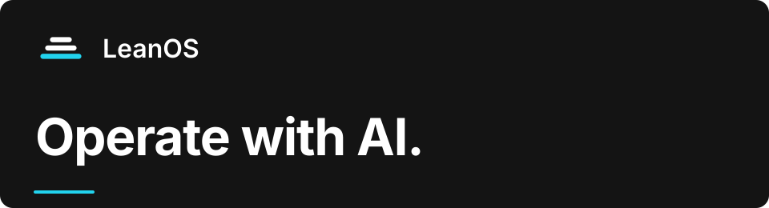

  

<h1 align="center">Operating and engineering with AI.</h1>

  Professional knowledge, methods and checks for your own coding agent. 
  You set the direction, examine the work and decide what counts.

  <a href="https://github.com/LeanOS-Technologies/content-atlas">Content Atlas</a> &nbsp; / &nbsp;
  <a href="https://github.com/LeanOS-Technologies/strategy">Strategy group</a> &nbsp; / &nbsp;
  <a href="https://www.leanos.tech/">LeanOS</a>

---

## Put professional structure behind your AI

LeanOS builds systems for doing useful work with AI. Each product gives your agent a field's knowledge, its methods and the programs that check the work. Files, decisions and results stay in your repository, ready for the next session.

LeanOS is itself a venture operated this way. We build and use these capabilities in our own work, then make them available to other people and businesses.

## Start with a free product

<table>
  <tr>
    <td width="50%" valign="top">
      <h3>Content Atlas</h3>
      
<strong>See what your content could do.</strong>

      
Explore formats, channels, placements and connections for your audience. Resolve a question, map existing content or narrow a result to your focus.

      
Free under MIT · Your own agent · JSON + Excel

      <a href="https://github.com/LeanOS-Technologies/content-atlas">Open Content Atlas →</a>
    </td>
    <td width="50%" valign="top">
      <h3>Strategy group</h3>
      
<strong>Define the business. Give work a path.</strong>

      
Four specialists develop the venture definition, market choices, positioning, revenue model, offers and prices. You settle the decisions and accept the documents.

      
Free under MIT · 4 specialists · Markdown documents

      <a href="https://github.com/LeanOS-Technologies/strategy">Open the Strategy group →</a>
    </td>
  </tr>
</table>

## Three product families

| Family | What it makes possible | Products |
| --- | --- | --- |
| **Atlases** | See a field's possibilities and their reasons, then choose. | Content Atlas · Webpage Atlas |
| **Workers** | Give your agent a specialist's methods, knowledge and responsibility for an area of work. | Strategy group |
| **Operating systems** | Build and test a working system on a domain's foundations, contracts and libraries. | OptionsOS |

Webpage Atlas explores one page's purposes, sections and layouts. OptionsOS provides the foundations for engineering crypto-options trading engines. They are licensed products delivered through private repositories. [Read the OptionsOS public overview](https://github.com/LeanOS-Technologies/options-os-public).

Free products are public repositories. Paid products are private repositories and may have a public overview. Each product works through your own agent; the work you produce with it is yours.

## Your direction. Work that stays useful.

Bring a request and the material you have. Your agent applies the relevant methods, programs check their declared properties, and decisions that need your judgment return to you. Accepted documents and useful results remain available for related work.

We also build custom AI workers and connected systems for a venture's work. [Talk to LeanOS](mailto:bella@leanos.tech) about the capability you need.

---

  <strong>LeanOS Technologies</strong> 
  <a href="https://www.leanos.tech/">www.leanos.tech</a> &nbsp;·&nbsp;
  <a href="mailto:bella@leanos.tech">bella@leanos.tech</a>

